# Autonomous Plant Platform

A simulator-first, vendor-independent industrial operations and decision-support platform designed to be adaptable to hydroelectric, solar, wind and industrial production facilities.

> Current release: **v0.2 — Hydroelectric Plant Simulator MVP**
>
> No real PLC, SCADA, RTU, protection system or field device is connected.

---

## Overview

Autonomous Plant Platform is an experimental software architecture for intelligent industrial plant operation.

The project separates plant-specific equipment from the core decision and safety logic so that the same platform can later be adapted to different types of facilities.

The first reference implementation is a simulated two-unit hydroelectric power plant.

The current HES prototype includes:

- Plant digital twin
- Unit start/stop state machine
- Plant-level MW target
- Multi-unit dispatch
- Unit power setpoints
- Pelton turbine model
- Governor logic
- Safety validation
- Alarm detection
- Alarm history
- Simulation scenarios
- Rule-based anomaly detection
- Machine-learning anomaly detection
- Decision-support engine
- FastAPI REST API
- Automated tests
- End-to-end demonstration

---

## Project Vision

The long-term architecture is intended to support multiple plant types through adapter layers.

```text
                  Autonomous Plant Platform

                         Operator
                            |
                            v
                    Decision Engine
                            |
                            v
                     Safety Engine
                            |
                            v
                 Scheduler / Dispatch
                            |
                            v
                    Command Manager
                            |
             +--------------+--------------+
             |              |              |
             v              v              v
        Hydro Adapter   Solar Adapter   Wind Adapter
             |              |              |
             v              v              v
            HES            GES            RES

                         Future:
                            |
                            v
                  Industrial Plants
```

The core platform is therefore not intended to be tied to a specific PLC, SCADA vendor or turbine manufacturer.

---

## Current HES Architecture

```mermaid
flowchart TD

    A[Operator / API] --> B[Plant Power Target]

    B --> C[Scheduler / Dispatch]

    C --> D[Safety Engine]

    D --> E[Hydro Plant Simulator]

    E --> F[Governor]

    F --> G[Pelton Turbine Model]

    G --> H[Plant State / Telemetry]

    H --> I[Alarm Engine]

    H --> J[Rule-Based Anomaly Detection]

    H --> K[IsolationForest ML Model]

    I --> L[Decision Engine]
    J --> L
    K --> L

    L --> M[Operator Recommendations]

    H --> N[FastAPI]

    N --> A
```



---

## Safety Architecture

Machine-learning output does **not** directly control the simulated plant.

The intended architecture is:

```text
ML / AI Analysis
       |
       v
Decision Recommendation
       |
       v
Safety Validation
       |
       v
Command Layer
       |
       v
Plant Adapter
```

In a future real-world implementation, independent PLC protection, interlocks, emergency systems and OEM safety systems would remain authoritative.

---

## Hydroelectric Digital Twin

The current simulator contains two hydroelectric generating units.

Each unit models operational values such as:

```text
Status
Active power
Reactive power
Voltage
Current
Frequency
RPM
Water flow
Bearing temperature
Generator temperature
Vibration
Needle opening
Power setpoint
Governor target
```

The simulator supports the following unit states:

```text
STOPPED
STARTING
RUNNING
STOPPING
FAULT
```

---

## Plant-Level Dispatch

The platform can receive a total plant production target.

Example:

```text
Plant target = 20 MW
```

With two equal 15 MW units, the scheduler can dispatch:

```text
UNIT_1 = 10 MW
UNIT_2 = 10 MW
```

The power command then flows through:

```text
Plant Target
     |
     v
Scheduler
     |
     v
Unit Setpoints
     |
     v
Governor
     |
     v
Pelton Needle Position
     |
     v
Water Flow
     |
     v
Electrical Power
```

---

## Pelton Turbine Model

The hydro simulator includes a simplified Pelton turbine model.

Hydraulic power is calculated using:

```text
P = rho * g * Q * H * eta_turbine * eta_generator
```

where:

```text
rho = water density
g   = gravitational acceleration
Q   = flow
H   = net hydraulic head
```

Jet velocity is based on:

```text
v = sqrt(2 * g * H)
```

Needle opening determines simulated nozzle flow.

The current parameters are demonstration values and are **not OEM or real plant parameters**.

---

## Governor

The governor combines:

```text
Feedforward control
+
Proportional feedback
+
Needle movement rate limiting
```

The purpose of the governor is to move the turbine toward the requested MW setpoint while avoiding instantaneous actuator movement.

---

## Safety Engine

Before control requests are accepted, the Safety Engine validates plant and unit conditions.

Examples include:

```text
Emergency stop
Maintenance lock
Grid availability
Unit state
Unit fault
Reservoir/headpond condition
Bearing temperature
Vibration
Requested power range
Installed plant capacity
```

Invalid commands are rejected before reaching the simulated plant.

---

## Alarm Engine

The system currently detects conditions including:

```text
GRID_LOSS
UNIT_FAULT
HIGH_BEARING_TEMPERATURE
HIGH_VIBRATION
```

Alarm history stores when an alarm was first observed during simulation.

---

## Simulation Scenarios

The simulator supports synthetic operational scenarios for testing.

Examples:

```text
NORMAL
DEMAND_INCREASE
UNIT_FAULT
HIGH_TEMPERATURE
HIGH_VIBRATION
GRID_LOSS
LOW_HEADPOND
```

These scenarios make it possible to test system behavior without real industrial equipment.

---

## Rule-Based Anomaly Detection

The project contains a deterministic anomaly-analysis layer.

It currently evaluates:

```text
Bearing temperature
Vibration
Frequency deviation
```

The output includes:

```text
Anomaly code
Severity
Risk score
Message
Affected unit
```

---

## Machine Learning Anomaly Detection

The HES prototype also includes an Isolation Forest anomaly detector implemented with scikit-learn.

Features currently include:

```text
Bearing temperature
Generator temperature
Vibration
Frequency
RPM
Active power fraction
```

The model is trained using synthetic normal-operation data.

Training:

```bash
python train_anomaly_model.py
```

The trained model is stored as:

```text
models/hes_anomaly_iforest.joblib
```

The current ML implementation is a prototype.

The anomaly score is **not a failure probability**.

In a real plant implementation, the model would require training, validation and calibration using authorized plant historian and maintenance data.

---

## Decision Engine

Alarm, rule-based anomaly and ML outputs are combined by the Decision Engine.

Example normal recommendation:

```text
CONTINUE_NORMAL_OPERATION
```

Example abnormal recommendations:

```text
KEEP_GENERATION_BLOCKED
OPERATOR_REVIEW_REQUIRED
INSPECT_UNIT
REVIEW_ML_ANOMALY
HOLD_AUTONOMOUS_COMMANDS
```

The Decision Engine produces recommendations.

It does not bypass the Safety Engine.

---

## System Assessment

A combined endpoint exposes the main analytical layers in one response:

```text
GET /api/v1/system/assessment
```

It includes:

```text
Simulation time
Total active power
Plant power target
Active alarms
Rule-based anomalies
ML anomalies
Decision recommendations
```

---

## API

The simulator exposes a FastAPI REST interface.

Start the server:

```bash
python -m uvicorn app.main:app --reload
```

Then open:

```text
http://127.0.0.1:8000/docs
```

Swagger UI can be used to interact with the simulator.

Important API groups include:

```text
GET  /health

GET  /api/v1/plant
GET  /api/v1/system/assessment

GET  /api/v1/alarms/active
GET  /api/v1/alarms/history

GET  /api/v1/anomalies
GET  /api/v1/ml/anomalies
GET  /api/v1/decisions

GET  /api/v1/sim/runtime

POST /api/v1/plant/power-setpoint

POST /api/v1/units/{unit_id}/start
POST /api/v1/units/{unit_id}/stop
POST /api/v1/units/{unit_id}/power-setpoint

POST /api/v1/sim/tick
POST /api/v1/sim/scenario
POST /api/v1/sim/auto
```

---

## End-to-End Demo

The repository contains a command-line demonstration.

Run:

```bash
python demo_hes.py
```

The demo performs the following flow:

```text
Create HES digital twin

        ↓

Request 20 MW plant production

        ↓

Scheduler selects two units

        ↓

UNIT_1 → 10 MW
UNIT_2 → 10 MW

        ↓

Governor + Pelton simulation

        ↓

Alarm analysis

        ↓

Rule-based anomaly analysis

        ↓

IsolationForest ML analysis

        ↓

Decision Engine

        ↓

GRID_LOSS simulation

        ↓

Critical alarm

        ↓

Operator recommendation

        ↓

Alarm history
```

Example healthy operation:

```text
Plant power : 20.00 MW

UNIT_1 : 10.00 MW
UNIT_2 : 10.00 MW

No active alarms.
No rule-based anomaly detected.

Decision:
CONTINUE_NORMAL_OPERATION
```

Example simulated grid-loss response:

```text
GRID_LOSS

Severity:
CRITICAL

Recommendations:

KEEP_GENERATION_BLOCKED
OPERATOR_REVIEW_REQUIRED
```

---

## Automated Tests

Run:

```bash
python -m pytest -q
```

Current HES MVP:

```text
79 passed
```

The tests cover areas including:

```text
Safety validation
Scheduler
Plant dispatch
Hydro physics
Governor
Unit state transitions
Simulation scenarios
Alarm engine
Alarm history
Rule anomaly detection
ML anomaly detection
Decision engine
FastAPI endpoints
System assessment
```

---

## Installation

Clone the repository:

```bash
git clone <repository-url>
cd autonomous-plant-platform
```

Create a virtual environment:

```bash
python -m venv .venv
```

Activate on Linux:

```bash
source .venv/bin/activate
```

Install dependencies:

```bash
python -m pip install -r requirements.txt
```

Train the demonstration anomaly model:

```bash
python train_anomaly_model.py
```

Run tests:

```bash
python -m pytest -q
```

Run the demonstration:

```bash
python demo_hes.py
```

Start the API:

```bash
python -m uvicorn app.main:app --reload
```

---

## Repository Structure

```text
autonomous-plant-platform/
│
├── app/
│   └── main.py
│
├── core/
│   ├── alarms.py
│   ├── anomaly.py
│   ├── decision.py
│   ├── governor.py
│   ├── models.py
│   ├── safety.py
│   └── scheduler.py
│
├── ml/
│   ├── __init__.py
│   └── anomaly_model.py
│
├── simulator/
│   ├── hydro.py
│   ├── hydro_physics.py
│   └── scenarios.py
│
├── models/
│   └── hes_anomaly_iforest.joblib
│
├── tests/
│
├── demo_hes.py
├── train_anomaly_model.py
├── requirements.txt
└── README.md
```

---

## Current Status

### v0.2 — Hydroelectric Plant Simulator MVP

The HES reference implementation is functionally complete as a simulator-first prototype.

Current scope:

```text
Digital twin
Safety
Dispatch
Governor
Hydraulic simulation
Alarms
Scenarios
Anomaly detection
Machine learning
Decision support
REST API
Automated testing
End-to-end demonstration
```

---

## Future Development

The next architectural stage is to separate the current HES implementation behind a formal plant-adapter interface.

Future modules may include:

```text
Hydro Plant Adapter
Solar Plant Adapter
Wind Plant Adapter
Industrial Plant Adapter
```

Possible future integrations include industrial communication protocols and SCADA/PLC interfaces.

Such integrations would require site-specific engineering, authorization, cybersecurity controls, independent safety systems and field validation.

---

## Important Safety Notice

This project is currently a **software simulation and research prototype**.

It must not be used to directly control real turbines, generators, breakers, gates, PLCs, SCADA systems or other industrial equipment without appropriate professional engineering, independent safety layers, cybersecurity controls, hardware validation and site-specific commissioning.

All current plant values, limits, turbine parameters and operating scenarios are synthetic demonstration values.

---

## Goal

The long-term goal is to create a common software core capable of supporting intelligent operation and decision support across different energy and industrial facilities while keeping plant-specific integration isolated behind adapter layers.

```text
One Core Platform
      |
      +---- HES
      |
      +---- GES
      |
      +---- RES
      |
      +---- Industrial Plants
```