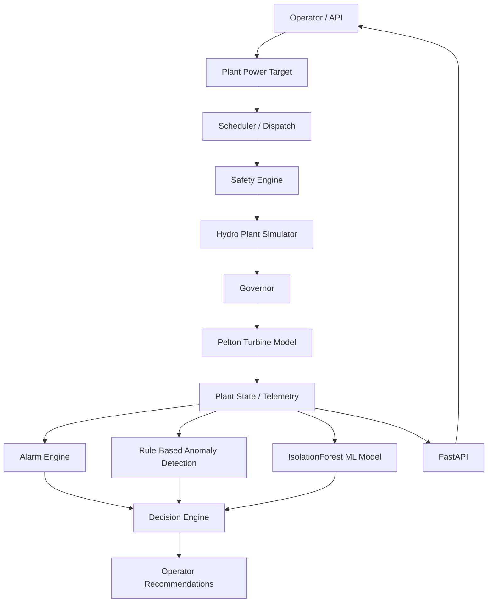
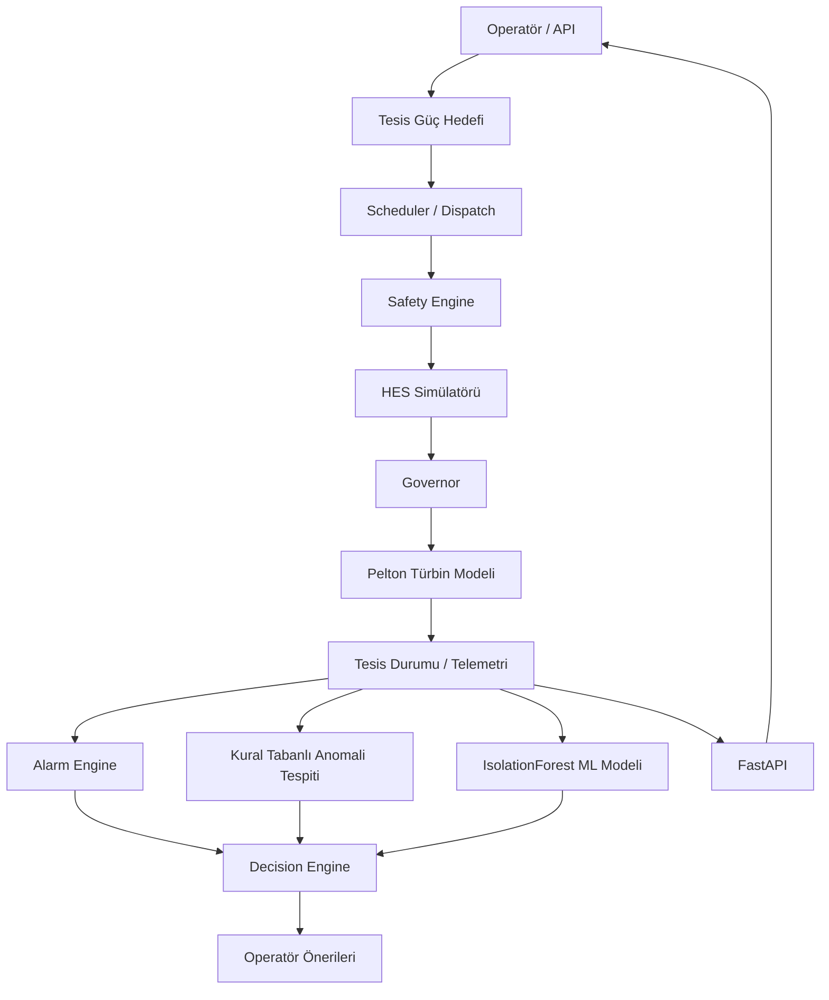

# Autonomous Plant Platform

**Vendor-independent autonomous industrial plant operations and decision-support platform.**  
**Üretici bağımsız, otonom endüstriyel tesis işletim ve karar destek platformu.**

> **Current release / Güncel sürüm:** `v0.2.0 — Hydroelectric Plant Simulator MVP`
>
> No real PLC, SCADA, RTU, protection system or field device is connected.  
> Gerçek PLC, SCADA, RTU, koruma sistemi veya saha ekipmanı bağlı değildir.

---

## Language / Dil

- [English](#english)
- [Türkçe](#turkce)

---

<a id="english"></a>

# English

## Overview

Autonomous Plant Platform is a simulator-first, vendor-independent software architecture for intelligent operation and decision support in energy generation and industrial facilities.

The project separates plant-specific equipment from the common decision, safety, scheduling and analytics layers. This allows the same core architecture to later be adapted to different types of facilities.

The first reference implementation is a simulated two-unit hydroelectric power plant.

The current HES prototype includes:

- Plant digital twin
- Unit start/stop state machine
- Plant-level MW target
- Multi-unit dispatch
- Unit power setpoints
- Pelton turbine model
- Governor logic
- Safety validation
- Alarm detection
- Alarm history
- Simulation scenarios
- Rule-based anomaly detection
- Machine-learning anomaly detection
- Decision-support engine
- FastAPI REST API
- Automated tests
- End-to-end demonstration

---

## Project Vision

The long-term goal is to build one common platform that can later support different energy-generation and industrial facilities through adapter layers.

```text
                  Autonomous Plant Platform

                         Operator
                            |
                            v
                    Decision Engine
                            |
                            v
                     Safety Engine
                            |
                            v
                 Scheduler / Dispatch
                            |
                            v
                    Command Manager
                            |
             +--------------+--------------+
             |              |              |
             v              v              v
        Hydro Adapter   Solar Adapter   Wind Adapter
             |              |              |
             v              v              v
            HES            GES            RES

                         Future
                            |
                            v
                  Industrial Plants
```

The core platform is not intended to depend on a specific PLC, SCADA vendor, turbine manufacturer or plant type.

---

## Current HES Architecture



---

## Safety Architecture

Machine-learning output does **not** directly control the simulated plant.

The intended architecture is:

```text
ML / AI Analysis
       |
       v
Decision Recommendation
       |
       v
Safety Validation
       |
       v
Command Layer
       |
       v
Plant Adapter
```

In a future real-world implementation, independent PLC protection, interlocks, emergency systems and OEM safety systems would remain authoritative.

---

## Hydroelectric Digital Twin

The current simulator contains two hydroelectric generating units.

Each unit models operational values such as:

```text
Status
Active power
Reactive power
Voltage
Current
Frequency
RPM
Water flow
Bearing temperature
Generator temperature
Vibration
Needle opening
Power setpoint
Governor target
```

Supported unit states:

```text
STOPPED
STARTING
RUNNING
STOPPING
FAULT
```

---

## Plant-Level Dispatch

The platform can receive a total plant production target.

Example:

```text
Plant target = 20 MW
```

With two equal 15 MW units:

```text
UNIT_1 = 10 MW
UNIT_2 = 10 MW
```

Control flow:

```text
Plant Target
     |
     v
Scheduler
     |
     v
Unit Setpoints
     |
     v
Governor
     |
     v
Pelton Needle Position
     |
     v
Water Flow
     |
     v
Electrical Power
```

---

## Pelton Turbine Model

The simulator contains a simplified Pelton turbine model.

Hydraulic power is calculated using:

```text
P = rho * g * Q * H * eta_turbine * eta_generator
```

where:

```text
rho = water density
g   = gravitational acceleration
Q   = flow
H   = net hydraulic head
```

Jet velocity:

```text
v = sqrt(2 * g * H)
```

Needle opening determines the simulated nozzle flow.

Current turbine parameters are synthetic demonstration values and are **not OEM or real plant parameters**.

---

## Governor

The governor combines:

```text
Feedforward control
+
Proportional feedback
+
Needle movement rate limiting
```

Its purpose is to move the turbine toward the requested MW setpoint while preventing unrealistic instantaneous actuator movement.

---

## Safety Engine

Before control requests are accepted, the Safety Engine checks plant and unit conditions.

Examples:

```text
Emergency stop
Maintenance lock
Grid availability
Unit state
Unit fault
Reservoir / headpond condition
Bearing temperature
Vibration
Requested power range
Installed plant capacity
```

Invalid requests are rejected before reaching the simulated plant.

---

## Alarm Engine

Currently supported alarm conditions include:

```text
GRID_LOSS
UNIT_FAULT
HIGH_BEARING_TEMPERATURE
HIGH_VIBRATION
```

Alarm history records when an alarm was first observed during simulation.

---

## Simulation Scenarios

Synthetic scenarios are available for testing system behavior.

```text
NORMAL
DEMAND_INCREASE
UNIT_FAULT
HIGH_TEMPERATURE
HIGH_VIBRATION
GRID_LOSS
LOW_HEADPOND
```

These scenarios allow the platform to be tested without real industrial hardware.

---

## Rule-Based Anomaly Detection

The deterministic anomaly layer currently evaluates:

```text
Bearing temperature
Vibration
Frequency deviation
```

Outputs include:

```text
Anomaly code
Severity
Risk score
Message
Affected unit
```

---

## Machine Learning Anomaly Detection

The HES prototype also includes an Isolation Forest anomaly detector implemented with scikit-learn.

Current features:

```text
Bearing temperature
Generator temperature
Vibration
Frequency
RPM
Active power fraction
```

The model is trained using synthetic normal-operation data.

Train the model:

```bash
python train_anomaly_model.py
```

Generated model:

```text
models/hes_anomaly_iforest.joblib
```

The current ML implementation is a prototype.

The anomaly score is **not a failure probability**.

A real plant implementation would require authorized historian data, maintenance data, model validation and site-specific calibration.

---

## Decision Engine

Alarm, rule-based anomaly and ML outputs are combined by the Decision Engine.

Example normal recommendation:

```text
CONTINUE_NORMAL_OPERATION
```

Example abnormal recommendations:

```text
KEEP_GENERATION_BLOCKED
OPERATOR_REVIEW_REQUIRED
INSPECT_UNIT
REVIEW_ML_ANOMALY
HOLD_AUTONOMOUS_COMMANDS
```

The Decision Engine produces recommendations.

It does not bypass the Safety Engine.

---

## System Assessment

The platform provides a combined system assessment endpoint:

```text
GET /api/v1/system/assessment
```

It returns:

```text
Simulation time
Total active power
Plant power target
Active alarms
Rule-based anomalies
ML anomalies
Decision recommendations
```

---

## API

Start the FastAPI server:

```bash
python -m uvicorn app.main:app --reload
```

Swagger UI:

```text
http://127.0.0.1:8000/docs
```

Important endpoints:

```text
GET  /health
GET  /api/v1/plant
GET  /api/v1/system/assessment
GET  /api/v1/alarms/active
GET  /api/v1/alarms/history
GET  /api/v1/anomalies
GET  /api/v1/ml/anomalies
GET  /api/v1/decisions
GET  /api/v1/sim/runtime
POST /api/v1/plant/power-setpoint
POST /api/v1/units/{unit_id}/start
POST /api/v1/units/{unit_id}/stop
POST /api/v1/units/{unit_id}/power-setpoint
POST /api/v1/sim/tick
POST /api/v1/sim/scenario
POST /api/v1/sim/auto
```

---

## End-to-End Demo

Run:

```bash
python demo_hes.py
```

Demo flow:

```text
Create HES digital twin
        ↓
Request 20 MW plant production
        ↓
Scheduler selects two units
        ↓
UNIT_1 → 10 MW
UNIT_2 → 10 MW
        ↓
Governor + Pelton simulation
        ↓
Alarm analysis
        ↓
Rule-based anomaly analysis
        ↓
IsolationForest ML analysis
        ↓
Decision Engine
        ↓
GRID_LOSS simulation
        ↓
Critical alarm
        ↓
Operator recommendation
        ↓
Alarm history
```

Healthy operation example:

```text
Plant power : 20.00 MW
UNIT_1 : 10.00 MW
UNIT_2 : 10.00 MW
No active alarms.
No rule-based anomaly detected.
Decision:
CONTINUE_NORMAL_OPERATION
```

Grid-loss example:

```text
GRID_LOSS
Severity:
CRITICAL
Recommendations:
KEEP_GENERATION_BLOCKED
OPERATOR_REVIEW_REQUIRED
```

---

## Automated Tests

Run:

```bash
python -m pytest -q
```

Current HES MVP:

```text
79 passed
```

Test coverage includes:

```text
Safety validation
Scheduler
Plant dispatch
Hydro physics
Governor
Unit state transitions
Simulation scenarios
Alarm engine
Alarm history
Rule anomaly detection
ML anomaly detection
Decision engine
FastAPI endpoints
System assessment
```

---

## Installation

Clone the repository:

```bash
git clone https://github.com/semihkbacak/autonomous-plant-platform.git
cd autonomous-plant-platform
```

Create a virtual environment:

```bash
python -m venv .venv
```

Activate on Linux:

```bash
source .venv/bin/activate
```

Install dependencies:

```bash
python -m pip install -r requirements.txt
```

Train the demo ML model:

```bash
python train_anomaly_model.py
```

Run tests:

```bash
python -m pytest -q
```

Run the demo:

```bash
python demo_hes.py
```

Start the API:

```bash
python -m uvicorn app.main:app --reload
```

---

## Repository Structure

```text
autonomous-plant-platform/
│
├── app/
│   └── main.py
│
├── core/
│   ├── alarms.py
│   ├── anomaly.py
│   ├── decision.py
│   ├── governor.py
│   ├── models.py
│   ├── safety.py
│   └── scheduler.py
│
├── ml/
│   ├── __init__.py
│   └── anomaly_model.py
│
├── simulator/
│   ├── hydro.py
│   ├── hydro_physics.py
│   └── scenarios.py
│
├── models/
│   └── hes_anomaly_iforest.joblib
│
├── tests/
│
├── demo_hes.py
├── train_anomaly_model.py
├── requirements.txt
└── README.md
```

---

## Current Status

### v0.2.0 — Hydroelectric Plant Simulator MVP

The HES reference implementation is functionally complete as a simulator-first prototype.

Current scope:

```text
Digital twin
Safety
Dispatch
Governor
Hydraulic simulation
Alarms
Scenarios
Anomaly detection
Machine learning
Decision support
REST API
Automated testing
End-to-end demonstration
```

---

## Future Development

The next architectural stage is to formalize plant-specific adapter interfaces.

Future modules may include:

```text
Hydro Plant Adapter
Solar Plant Adapter
Wind Plant Adapter
Industrial Plant Adapter
```

Possible future integrations may include industrial communication protocols and PLC/SCADA interfaces.

Any real-world integration would require site-specific engineering, authorization, cybersecurity controls, independent safety systems and field validation.

---

## Important Safety Notice

This project is currently a **software simulation and research prototype**.

It must not be used to directly control real turbines, generators, breakers, gates, PLCs, SCADA systems or other industrial equipment without appropriate professional engineering, independent safety layers, cybersecurity controls, hardware validation and site-specific commissioning.

All current plant values, limits, turbine parameters and operating scenarios are synthetic demonstration values.

---

## Goal

The long-term goal is to create a common software core capable of supporting intelligent operation and decision support across multiple energy and industrial facilities.

```text
One Core Platform
      |
      +---- HES
      |
      +---- GES
      |
      +---- RES
      |
      +---- Industrial Plants
```

---

<a id="turkce"></a>

# Türkçe

## Genel Bakış

Autonomous Plant Platform; enerji üretim tesisleri ve endüstriyel tesislerde akıllı işletim, analiz ve karar desteği sağlamak amacıyla geliştirilen, **simülatör öncelikli ve üretici bağımsız** bir yazılım mimarisidir.

Proje; tesise özel ekipmanları ortak karar, güvenlik, planlama ve analiz katmanlarından ayırır. Böylece aynı çekirdek yazılımın gelecekte farklı tesis tiplerine uyarlanabilmesi hedeflenmektedir.

İlk referans uygulama, iki üretim ünitesinden oluşan simüle edilmiş bir hidroelektrik santraldir.

Mevcut HES prototipi şunları içerir:

- Tesis dijital ikizi
- Ünite başlatma/durdurma durum makinesi
- Tesis seviyesinde MW hedefi
- Çoklu ünite güç dağıtımı
- Ünite güç setpoint kontrolü
- Pelton türbin modeli
- Governor kontrol mantığı
- Güvenlik doğrulama katmanı
- Alarm tespiti
- Alarm geçmişi
- Simülasyon senaryoları
- Kural tabanlı anomali tespiti
- Makine öğrenmesi ile anomali tespiti
- Karar destek motoru
- FastAPI REST API
- Otomatik testler
- Uçtan uca demo

---

## Proje Vizyonu

Uzun vadeli hedef, farklı enerji üretim ve endüstriyel tesisleri adapter katmanları üzerinden destekleyebilen ortak bir platform geliştirmektir.

```text
                  Autonomous Plant Platform

                         Operatör
                            |
                            v
                       Karar Motoru
                            |
                            v
                     Güvenlik Motoru
                            |
                            v
                 Scheduler / Dispatch
                            |
                            v
                       Komut Katmanı
                            |
             +--------------+--------------+
             |              |              |
             v              v              v
        HES Adapter     GES Adapter     RES Adapter
             |              |              |
             v              v              v
            HES            GES            RES

                         Gelecek
                            |
                            v
                  Endüstriyel Tesisler
```

Çekirdek platform belirli bir PLC, SCADA üreticisi, türbin üreticisi veya tesis tipine bağımlı olacak şekilde tasarlanmamıştır.

---

## Mevcut HES Mimarisi



---

## Güvenlik Mimarisi

Makine öğrenmesi çıktısı simüle edilmiş tesisi **doğrudan kontrol etmez**.

Tasarlanan akış:

```text
ML / AI Analizi
       |
       v
Karar Önerisi
       |
       v
Güvenlik Doğrulaması
       |
       v
Komut Katmanı
       |
       v
Tesis Adapterı
```

Gelecekte gerçek bir tesis uygulamasında PLC korumaları, interlocklar, acil durum sistemleri ve OEM güvenlik sistemleri yetkili güvenlik katmanları olarak kalmalıdır.

---

## Hidroelektrik Dijital İkiz

Mevcut simülatörde iki hidroelektrik üretim ünitesi bulunmaktadır.

Her ünitede aşağıdaki gibi değerler modellenir:

```text
Durum
Aktif güç
Reaktif güç
Gerilim
Akım
Frekans
RPM
Su debisi
Yatak sıcaklığı
Jeneratör sıcaklığı
Titreşim
Needle açıklığı
Güç setpoint değeri
Governor hedefi
```

Desteklenen ünite durumları:

```text
STOPPED
STARTING
RUNNING
STOPPING
FAULT
```

---

## Tesis Seviyesi Güç Dağıtımı

Platform toplam tesis üretim hedefi alabilir.

Örnek:

```text
Tesis hedefi = 20 MW
```

İki adet eşit 15 MW ünite için:

```text
UNIT_1 = 10 MW
UNIT_2 = 10 MW
```

Kontrol akışı:

```text
Tesis Hedefi
     |
     v
Scheduler
     |
     v
Ünite Setpointleri
     |
     v
Governor
     |
     v
Pelton Needle Pozisyonu
     |
     v
Su Debisi
     |
     v
Elektriksel Güç
```

---

## Pelton Türbin Modeli

HES simülatörü basitleştirilmiş bir Pelton türbin modeli içerir.

Hidrolik güç:

```text
P = rho * g * Q * H * eta_turbine * eta_generator
```

Burada:

```text
rho = su yoğunluğu
g   = yerçekimi ivmesi
Q   = debi
H   = net düşü
```

Jet hızı:

```text
v = sqrt(2 * g * H)
```

Needle açıklığı simüle edilen nozül debisini belirler.

Mevcut türbin parametreleri tamamen demo amaçlı sentetik değerlerdir ve **gerçek tesis veya OEM parametreleri değildir**.

---

## Governor

Governor kontrolü şu bileşenleri birlikte kullanır:

```text
Feedforward kontrol
+
Oransal geri besleme
+
Needle hareket hız sınırlaması
```

Amaç, türbini talep edilen MW setpoint değerine doğru hareket ettirirken gerçekçi olmayan ani aktüatör değişimlerini önlemektir.

---

## Güvenlik Motoru

Kontrol talepleri kabul edilmeden önce Safety Engine tesis ve ünite koşullarını kontrol eder.

Örnek kontroller:

```text
Emergency stop
Bakım kilidi
Şebeke kullanılabilirliği
Ünite durumu
Ünite arızası
Rezervuar / headpond durumu
Yatak sıcaklığı
Titreşim
Talep edilen güç aralığı
Kurulu tesis kapasitesi
```

Geçersiz talepler simüle edilmiş tesise ulaşmadan reddedilir.

---

## Alarm Motoru

Şu anda desteklenen alarm durumlarından bazıları:

```text
GRID_LOSS
UNIT_FAULT
HIGH_BEARING_TEMPERATURE
HIGH_VIBRATION
```

Alarm geçmişi, bir alarmın simülasyon sırasında ilk görüldüğü zamanı saklar.

---

## Simülasyon Senaryoları

Sistemin davranışını test etmek için sentetik senaryolar bulunmaktadır.

```text
NORMAL
DEMAND_INCREASE
UNIT_FAULT
HIGH_TEMPERATURE
HIGH_VIBRATION
GRID_LOSS
LOW_HEADPOND
```

Bu senaryolar sayesinde gerçek endüstriyel ekipman olmadan sistem davranışı test edilebilir.

---

## Kural Tabanlı Anomali Tespiti

Deterministik anomali katmanı şu anda aşağıdaki değerleri değerlendirir:

```text
Yatak sıcaklığı
Titreşim
Frekans sapması
```

Üretilen sonuçlar:

```text
Anomali kodu
Önem derecesi
Risk skoru
Mesaj
Etkilenen ünite
```

---

## Makine Öğrenmesi ile Anomali Tespiti

HES prototipinde ayrıca scikit-learn ile geliştirilmiş bir Isolation Forest anomali modeli bulunmaktadır.

Kullanılan özellikler:

```text
Yatak sıcaklığı
Jeneratör sıcaklığı
Titreşim
Frekans
RPM
Aktif güç oranı
```

Model sentetik normal çalışma verileriyle eğitilmektedir.

Modeli eğitmek için:

```bash
python train_anomaly_model.py
```

Oluşturulan model:

```text
models/hes_anomaly_iforest.joblib
```

Mevcut ML sistemi bir prototiptir.

Anomali skoru **arıza olasılığı anlamına gelmez**.

Gerçek bir tesiste kullanılacak modelin yetkili historian verileri, bakım kayıtları ve gerçek saha verileriyle eğitilmesi, doğrulanması ve tesise özel kalibre edilmesi gerekir.

---

## Karar Motoru

Alarm, kural tabanlı anomali ve makine öğrenmesi sonuçları Decision Engine tarafından birleştirilir.

Normal çalışma önerisi:

```text
CONTINUE_NORMAL_OPERATION
```

Anormal durumlarda üretilebilen öneriler:

```text
KEEP_GENERATION_BLOCKED
OPERATOR_REVIEW_REQUIRED
INSPECT_UNIT
REVIEW_ML_ANOMALY
HOLD_AUTONOMOUS_COMMANDS
```

Decision Engine yalnızca öneri üretir.

Safety Engine'i devre dışı bırakmaz veya atlamaz.

---

## Sistem Değerlendirmesi

Ana analiz katmanları tek endpoint üzerinden alınabilir:

```text
GET /api/v1/system/assessment
```

Dönen bilgiler:

```text
Simülasyon zamanı
Toplam aktif güç
Tesis güç hedefi
Aktif alarmlar
Kural tabanlı anomaliler
ML anomalileri
Karar önerileri
```

---

## API

FastAPI sunucusunu başlatmak için:

```bash
python -m uvicorn app.main:app --reload
```

Swagger arayüzü:

```text
http://127.0.0.1:8000/docs
```

Önemli endpointler:

```text
GET  /health
GET  /api/v1/plant
GET  /api/v1/system/assessment
GET  /api/v1/alarms/active
GET  /api/v1/alarms/history
GET  /api/v1/anomalies
GET  /api/v1/ml/anomalies
GET  /api/v1/decisions
GET  /api/v1/sim/runtime
POST /api/v1/plant/power-setpoint
POST /api/v1/units/{unit_id}/start
POST /api/v1/units/{unit_id}/stop
POST /api/v1/units/{unit_id}/power-setpoint
POST /api/v1/sim/tick
POST /api/v1/sim/scenario
POST /api/v1/sim/auto
```

---

## Uçtan Uca Demo

Demo çalıştırmak için:

```bash
python demo_hes.py
```

Demo akışı:

```text
HES dijital ikizini oluştur
        ↓
20 MW tesis üretim hedefi gönder
        ↓
Scheduler iki üniteyi seçer
        ↓
UNIT_1 → 10 MW
UNIT_2 → 10 MW
        ↓
Governor + Pelton simülasyonu
        ↓
Alarm analizi
        ↓
Kural tabanlı anomali analizi
        ↓
IsolationForest ML analizi
        ↓
Decision Engine
        ↓
GRID_LOSS senaryosu
        ↓
Kritik alarm
        ↓
Operatör önerisi
        ↓
Alarm geçmişi
```

Sağlıklı çalışma örneği:

```text
Plant power : 20.00 MW
UNIT_1 : 10.00 MW
UNIT_2 : 10.00 MW
No active alarms.
No rule-based anomaly detected.
Decision:
CONTINUE_NORMAL_OPERATION
```

Simüle edilmiş şebeke kaybı:

```text
GRID_LOSS
Severity:
CRITICAL
Recommendations:
KEEP_GENERATION_BLOCKED
OPERATOR_REVIEW_REQUIRED
```

---

## Otomatik Testler

Testleri çalıştırmak için:

```bash
python -m pytest -q
```

Mevcut HES MVP:

```text
79 passed
```

Test edilen başlıca alanlar:

```text
Güvenlik doğrulaması
Scheduler
Tesis dispatch sistemi
Hidro fizik modeli
Governor
Ünite durum geçişleri
Simülasyon senaryoları
Alarm sistemi
Alarm geçmişi
Kural tabanlı anomali
ML anomali tespiti
Decision Engine
FastAPI endpointleri
System assessment
```

---

## Kurulum

Repository'yi klonla:

```bash
git clone https://github.com/semihkbacak/autonomous-plant-platform.git
cd autonomous-plant-platform
```

Sanal ortam oluştur:

```bash
python -m venv .venv
```

Linux üzerinde etkinleştir:

```bash
source .venv/bin/activate
```

Bağımlılıkları yükle:

```bash
python -m pip install -r requirements.txt
```

Demo ML modelini eğit:

```bash
python train_anomaly_model.py
```

Testleri çalıştır:

```bash
python -m pytest -q
```

Demoyu çalıştır:

```bash
python demo_hes.py
```

API'yi başlat:

```bash
python -m uvicorn app.main:app --reload
```

---

## Proje Klasör Yapısı

```text
autonomous-plant-platform/
│
├── app/
│   └── main.py
│
├── core/
│   ├── alarms.py
│   ├── anomaly.py
│   ├── decision.py
│   ├── governor.py
│   ├── models.py
│   ├── safety.py
│   └── scheduler.py
│
├── ml/
│   ├── __init__.py
│   └── anomaly_model.py
│
├── simulator/
│   ├── hydro.py
│   ├── hydro_physics.py
│   └── scenarios.py
│
├── models/
│   └── hes_anomaly_iforest.joblib
│
├── tests/
│
├── demo_hes.py
├── train_anomaly_model.py
├── requirements.txt
└── README.md
```

---

## Güncel Durum

### v0.2.0 — Hidroelektrik Santral Simülatörü MVP

HES referans uygulaması simülatör tabanlı bir prototip olarak fonksiyonel şekilde tamamlanmıştır.

Mevcut kapsam:

```text
Dijital ikiz
Güvenlik
Dispatch
Governor
Hidrolik simülasyon
Alarmlar
Senaryolar
Anomali tespiti
Makine öğrenmesi
Karar desteği
REST API
Otomatik testler
Uçtan uca demo
```

---

## Gelecek Geliştirmeler

Bir sonraki mimari aşama, tesise özel sistemleri resmi adapter arayüzlerinin arkasına taşımaktır.

Planlanan modüller:

```text
HES Adapter
GES Adapter
RES Adapter
Endüstriyel Tesis Adapterı
```

Gelecekte endüstriyel haberleşme protokolleri ile PLC/SCADA entegrasyonları eklenebilir.

Gerçek saha entegrasyonları; tesise özel mühendislik, yetkilendirme, siber güvenlik, bağımsız güvenlik sistemleri ve saha doğrulaması gerektirir.

---

## Önemli Güvenlik Uyarısı

Bu proje şu anda bir **yazılım simülasyonu ve araştırma prototipidir**.

Uygun profesyonel mühendislik, bağımsız güvenlik katmanları, siber güvenlik önlemleri, donanım doğrulaması ve tesise özel devreye alma işlemleri yapılmadan gerçek türbin, jeneratör, kesici, vana, kapak, PLC, SCADA veya diğer endüstriyel ekipmanları doğrudan kontrol etmek amacıyla kullanılmamalıdır.

Mevcut tüm tesis değerleri, sınırlar, türbin parametreleri ve çalışma senaryoları sentetik demo değerleridir.

---

## Amaç

Uzun vadeli hedef; farklı enerji üretim ve endüstriyel tesislerde akıllı işletim, analiz ve karar desteği sağlayabilecek ortak bir yazılım çekirdeği oluşturmaktır.

```text
Tek Çekirdek Platform
        |
        +---- HES
        |
        +---- GES
        |
        +---- RES
        |
        +---- Endüstriyel Tesisler
```

---

## Release

Current milestone:

```text
v0.2.0
Hydroelectric Plant Simulator MVP
79 automated tests passed
End-to-end HES demonstration working
```

Mevcut kilometre taşı:

```text
v0.2.0
Hidroelektrik Santral Simülatörü MVP
79 otomatik test başarılı
Uçtan uca HES demosu çalışıyor
```