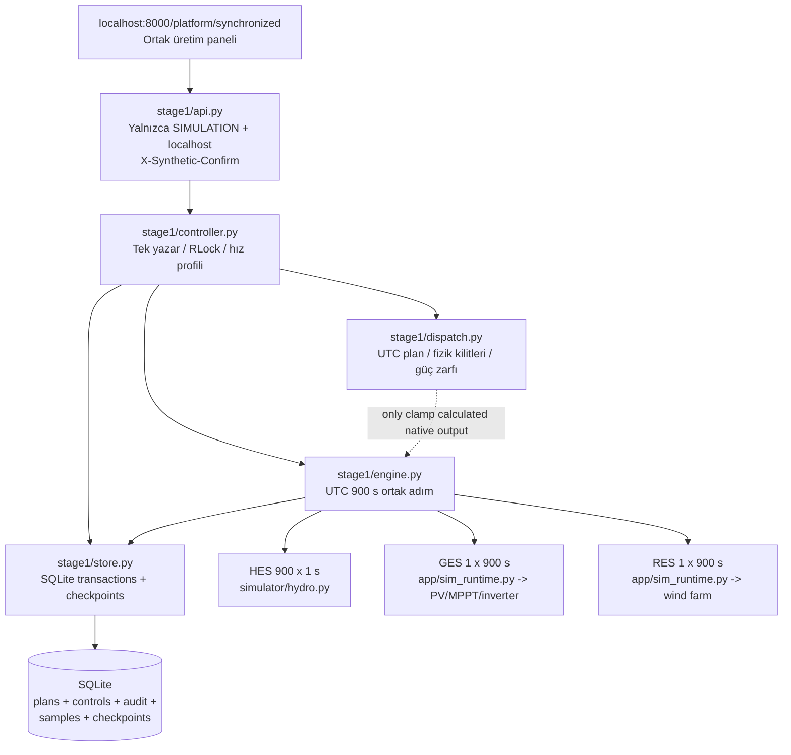

# Autonomous Plant Platform — UTC Üretim Planı ve Sentetik Güç Kontrolü

**Geliştirme revizyonu:** `development/utc-dispatch-p01` (henüz GitHub'a gönderilmedi)  
**Tarih:** 17 Ekim 2026  
**Kapsam:** Yalnızca sentetik simülasyon ve araştırma; gerçek PLC/SCADA, saha aktüatörü, enerji piyasası/şebeke setpoint bağlantısı bulunmaz.  
**Onay statüsü:** Geliştirme/ön-kabul. Gerçek saha FAT/SAT, OEM validasyonu, koruma koordinasyonu veya endüstriyel emniyet sertifikası **YOKTUR**.

## 1. Mühendislik özeti ve kanıt seviyesi

Yeni katman ortak UTC saatli üç santral simülatörünün **hesapladığı güçten daha fazla üretim raporlamadan** sentetik üretim programı ve manuel ihracat-gücü sınırlaması uygular. Bağımsız bir saha kumandası olarak tasarlanmamıştır. HES/GES/RES fizik motorlarının çekirdek algoritmaları değiştirilmedi; üstüne ortak çıkış/ihracat zarfı eklenmiştir. Önceki üretim planı tanımlanmamış oturumlarda, eski model üretimi korunur.

**Önemli ayrım:** Bu, şebeke senkronizasyonu/governor kontrol tasarımı değildir. Özellikle HES'te ihracat gücünü kısma kararı, aynı simülasyon adımında ünite kılavuz kanadı/nozul, su harcaması ve rezervuar durumuyla yeniden çözülmez. Dolayısıyla bu sürüm **kısıtlandırılmış üretim raporlama prototipi** olarak kabul edilmelidir; kapalı çevrim proses simülasyonu iddiası yapılamaz.

## 2. Yazılım mimarisi ve arayüz sınırları

Çalışan uygulamada `app/main.py` portföyün `auto_step()` fonksiyonunu bir arka döngüden `asyncio.to_thread` ile çağırır; eski bağımsız GES/RES ve gelişmiş araştırma oturumlarını bu revizyonda birleştirmiyoruz. `stage1` ortak saatli oturumunun geçmişi ayrı SQLite dosyasındadır; bağımsız tarihçi verilerini **eşzamanlıymış gibi** toplamak hâlâ hatalıdır.

### Veri şeması

- `runs`: UTC konfigürasyonu, etkin indeks, durum, kontrol noktası, SHA-256 ve örnekleme hash-zinciri.
- `samples`: adım başına **tam olarak** `HES`, `GES`, `RES` üçlüsü, UTC başlangıç/bitiş, güç (kW), enerji (kWh), kaynak bilgisi ve dispatch gerekçesi.
- `production_plans`: santral, `utc_start`, `utc_end`, hedef kW, `15 | 60 | 1440` dakika; hedef süresi tam seçilen granülerliğe eşit; aynı santralin örtüşen programları engellenir.
- `dispatch_controls`: santral başına `AUTO | START | STOP` ve isteğe bağlı kalıcı manuel setpoint. NULL manuel değerinin anlamı manuel override olmamasıdır.
- `dispatch_audit`: operatör değişiklikleri, reddedilen komutlar ve fiziksel kısıtlamalar; birbirine bağlanan SHA-256 hash alanları ve `UPDATE/DELETE` yasaklayıcı SQLite trigger'ları içerir.

Tüm saatler timezone-aware **UTC** ve tam 15 dakikalık sınırlara hizalıdır. Aralıklar `[başlangıç, bitiş)` şeklindedir. Plan yazma işlemi geçmişe dönük adımları değiştiremez; yalnızca henüz commit edilmemiş zaman aralıklarına izin verir. Tek olayın birden çok santral arasında aynı anda yazılması, `Coordinator` kilidi ve SQLite `BEGIN IMMEDIATE` ile sıralanır.

## 3. Fiziksel üretim ve matematiksel varsayımlar

### 3.1 HES modeli — kaynak koduna dayanan denklemler

Mevcut `simulator/hydro_physics.py` hidro güç hesabı:

\[
P_{HES,MW}=\frac{\rho_w g Q H_{net}\eta_t\eta_g}{10^6},\qquad
\rho_w=1000\;kg/m^3,\quad g=9.81\;m/s^2.
\]

\[
H_{net}=\max(0,H_{gross}-H_{loss}),\quad
Q_{jet}=C_d\frac{\pi D^2}{4}\sqrt{2gH_{net}}\;u\;n_{jet}.
\]

Burada `u` sınırlı nozul/needle açıklığı oranıdır. `simulator/hydro.py` motorunda gerçek sentetik HES ilerlemesi 1 saniyelik tick'lerle gerçekleşir; bir UTC slotunun **enerjisi** 900 ayrı örnekten hesaplanır:

\[
E_{HES,slot}[kWh]=\frac{1}{3600}\sum_{i=1}^{900}\sum_{j\in units} P_{j,i}[kW],\qquad
\overline{P}_{HES,slot}=4E_{HES,slot}.
\]

Simülasyonun HES iki ünitesi kod içinde 15 MW nominale sahiptir (toplam 30 MW). Bu, **OEM doğrulanmış kapasite değildir**. Su debisi, düşü, verim, durum makinesi, acil durdurma, bakım kilidi gibi sentetik koşullar alttaki fizik motorundadır. Yeni üst zarf ayrıca net düşü veya debinin sıfır olması durumunda ihracatı sıfıra zorlar.

### 3.2 GES modeli

Yerleşik GES pipeline'ında güneş ışınımı (`GHI/DNI/DHI`), ortam ve hücre sıcaklığı, rüzgâr, modül I–V/P–V modeli, bypass-gölgeleme, MPPT ve inverter/DC–AC limitleri ayrı bileşenlerde hesaplanır: `simulator/solar/pv_array.py`, `solar_temperature.py`, `multi_mppt_physics.py`, `inverter.py`, `solar_pipeline.py` ve `app/sim_runtime.py`.

Temel mühendislik ilişkileri: `P_DC(V)=V*I(V)`, `P_AC<=min(P_DC*eta_inv,P_inverter_limit)`; burada gerçek hesap ve sınırlayıcıların tam biçimi ilgili kaynak dosyalarında bulunur. Faiman hücre-sıcaklık yaklaşımı örnek olarak `T_module=T_air+G_POA/(u0+u1*v_wind)` üzerinde kuruludur; `u0/u1` üretici/saha validasyonuyla elde edilmiş katsayılar değildir. De Soto veya inverter verim katsayılarının hazır/yeterli OEM doğrulaması olduğu iddia edilmez. Güneş ışınımı sıfırsa ek dispatch katmanı gücü **0 kW**'a zorlar. Günlük meteoroloji **sentetik tekrar** verisidir; gerçek tarihli tahmin değildir.

### 3.3 RES modeli

Yerleşik `simulator/wind_physics.py` basitleştirilmiş rüzgâr türbini/farm fiziği kullanır: hub yüksekliğine güç kanunuyla dönüşüm, hava yoğunluğu `rho=p/(287.05*T_K)`, kesme/açma hızları, kübik sentetik güç eğrisi ve basit Jensen benzeri wake azaltımı. Yüksek rüzgâr trip/histerezis vardır. Genel teorik türbin gücü:

\[
P_{aero}=\tfrac12\rho A v^3 C_p(\lambda,\beta),\qquad P_{elec}\leq P_{rated}.
\]

Bu denklem, her iç uygulamanın tam OEM Cp yüzeyi kullandığı anlamına **gelmez**: mevcut düşük seviyeli modelde kodlanan eğri sentetik kübik rampadır. Üst kontrol zarfı referans rüzgârı `v<3 m/s` veya `v>25 m/s` ise sıfıra zorlar. Sınırlar bu sürümün demo santral varsayımlarıdır; farklı türbinlerin saha parametreleri ve hub hızları için yeniden kalibre edilmelidir.

### 3.4 Üretim planı ve kısıtlı çıkış formülü

Santral `p`, UTC slot `k` için hesaplanan orijinal güç `P_native,p,k`, üst sınır `P_ceiling,p` ve istenen güç `P_req,p,k` olsun. Öncelik sıralaması:

1. Operatör **STOP**: ihracat `0 kW`.
2. Kaynak/fizik kilidi: gecede GES ışınımı `0`, RES referans rüzgârı demo sınırı dışı veya HES net düşü/debi sıfırsa `0 kW`.
3. Manuel setpoint tanımlıysa, planı geçici olarak ezer; aksi halde etkin UTC plan hedefi kullanılır.
4. Santral için hiçbir üretim planı yok ve manuel setpoint yoksa, orijinal model çıkışı korunur. Plan tanımlanmış ancak mevcut UTC saatinde etkin aralık yoksa hedef `0 kW` olur.

\[
P_{out,p,k}=\begin{cases}
0,&\text{STOP veya kaynak kilidi},\\
\min(P_{native,p,k},P_{ceiling,p},P_{req,p,k}),&\text{hedef tanımlı},\\
\min(P_{native,p,k},P_{ceiling,p}),&\text{hedef tanımsız ve dispatch etkin}.
\end{cases}
\]

Üst zarf simülasyonunda enerji, yerleşik modelin slot enerjisine **aynı sabit azaltma oranı** uygulanarak raporlanır: `E_out=E_native*(P_out/P_native)` (orijinal güç sıfırsa `E_out=0`). Bu bir proses dengesi hesabı değildir. HES ünitesinin gerçek hidro-dinamik durumu aynı oranla yeniden çözülmediği için bu sürüm **bir dışa-aktarım/sunum zarfıdır**. Böylece ayarlanmış gücün, mevcut fiziksel hesaplamadan yüksek çıkması engellenir; ancak azaltılan su tüketimi fiziksel olarak geri yazılmaz.

\[
E_{schedule,entry}=P_{target,kW}\frac{\Delta t_{min}}{60}\;kWh,
\quad \Delta E_{elapsed}=E_{actual,elapsed}-E_{schedule,elapsed}.
\]

15 dakika için `E_expected=P(kW)*0.25`; saatlik için `*1`; günlük için `*24`. Rapor hem tam aralık beklenen enerjisini, hem UTC motorunun ilerlediği bölüm için beklenen/gerçekleşen ve sapmayı gösterir. `kW` ve `kWh` temel birimdir; `MW/MWh` dönüşümü 1000 çarpanı ile yapılır.

**Sınırların kaynağı:** HES 30.000 kW, GES/RES 100.000 kW sentetik ihracat üst tavanıdır; son iki sayı mühendislik amaçlı kaba güvenlik tavanıdır, inverter/türbin nameplate'inden türetilmiş sertifikalı saha gücü değildir. Gerçek model hesaplamasının üzerine yüksek çıkılmaz; her kurulumda parametreleştirilmiş kapasite katmanı henüz gereklidir.

## 4. Start/Stop, izinler ve operasyonel semantik

`/api/v2/clock/start` / `pause` = **portföy dijital saatini** başlat / durdur (eski API).  
`/api/v2/clock/plant-command` = yeni, santral başına **sentetik çıkış zarfını** `AUTO`, `START`, `STOP` durumuna alır; mekanik start/stop sekansı değildir.

Pozitif plan varlığı kontrol edilir; santralin programı mevcut zamanda sıfırsa manuel START reddedilir (pozitif manuel talep varsa istisna). GES/RES yerel `ESTOP`, `GRID_LOSS` veya `FAULT` senaryosu START isteğini engeller. HES native emergency-stop veya bakım kilidinde START engellenir. STOP her durumda sıfıra kapatır. Başlatılan talebin fiziksel gerçekleşmesi, gerçek bir sonraki UTC slotunda kaynak ve native modelin hesapladığı güç üzerinden belirlenir; güç yoksa pozitif üretim verilmez.

**Saha uyarısı:** Bu endpoint'leri gerçek operatör/PLC komutuna dönüştürmek **yasaktır**; bağımsız emniyet sistemi, yetkilendirme, interlock ve saha kabulü burada yoktur.

## 5. UTC deterministik yeniden başlatma ve SQLite güvenliği

Her adım için önce modelin HES 900 saniyelik iç ilerlemesi ve GES/RES 15 dakikalık çıktıları hesaplanır. Sonra dispatch uygulanır, checkpoint JSON+SHA-256 üretilir, ardından **tek `BEGIN IMMEDIATE`** transaction içinde üç örnek, fizik-limit audit olayları, yeni kontrol noktası, enerji ve zincir hash'i atomik yazılır. Yarım insert hata verirse transaction rollback olur. RAM'de ilerlemiş model hata durumuna alınır (`FAULT_LATCHED`); otomatik ilerlemez. Uygulama yeniden açıldığında **son doğrulanmış commit'ten** geri yükler. Bozulmuş checkpoint veya değişmiş audit/hash zincirinde **fail closed** uygulanır. `RUNNING` kaydı çökmenin ardından otomatik başlatılmaz; `PAUSED_RECOVERED` olur.

`dispatch_audit` zinciri yalnızca yerel yazılım bütünlüğü için faydalıdır; saldırganın tüm SQLite dosyasını ve kodu değiştirebildiği tehdit modeline karşı elektronik imza veya bağımsız WORM denetim defteri **değildir**.

## 6. Performans ve iş parçacığı sınırı

- Profil kodu: `python -m tools.profile_stage1 --toy-sessions --steps 8`; tam GES/RES fizik testi için `--toy-sessions` olmadan ve `pvlib` kurulu olarak tekrar koşulmalı.
- `Coordinator.profile` simülasyon+checkpoint üretimi ile SQLite transaction sürelerini **ayrı** `perf_counter` değerleriyle ölçer.
- `NORMAL`: mevcut 1 saniyelik uygulama döngüsünde iki turda bir simülasyon adımı; yaklaşık **2 saniyelik kasıtlı bekleme**.
- `FAST`: her uygulama döngüsünde 1 ortak slot.
- `MAX`: her uygulama döngüsünde en çok 4 ortak slot (tek yazıcı altında, arayüz için kontrolü thread havuzuna bırakarak).
- Her 15 dakika hâlâ HES'te 900 fiziksel tick'tir; GPU'ya geçiş yapılmadı. Bu revizyon gerçek fizikte paralelleştirme **yapmaz**. Çok uzun bloklar API durum sorgularını kilit bekletebilir; gerçek yüksek-hız stres testi ve UI gecikme ölçümü Windows QA'da gereklidir.
- Hız modu, hesaplama doğruluğunu/UTC çözünürlüğünü değiştirmez; otomatik bekleme tercihidir. Yeniden başlatma sonrası güvenli varsayılan `NORMAL`'dir.

## 7. HTTP arayüzleri ve yetki sınırları

Yazma endpoint'lerinde `APP_OPERATION_MODE=SIMULATION`, localhost istemcisi ve `X-Synthetic-Confirm: SYNTHETIC_ONLY` gereklidir; izin kontrolü `stage1/api.py` içindeki eski `write_gate` fonksiyonuna dayanır. Sunucu TCP bağlaması da localhost olmalıdır. JWT/kimlik doğrulama katmanı veya gerçek çok kullanıcılı işletme yetkilendirmesi eklenmemiştir.

| Endpoint | Metot | İçerik |
|---|---|---|
| `/api/v2/clock/status` | GET | UTC, güç/enerji, hız/profil, etkin setpoint |
| `/api/v2/clock/plan` | POST | santral, UTC başlangıç/bitiş, kW, 15/60/1440 dakika |
| `/api/v2/clock/plan/remove` | POST | yalnızca gelecek planı kaldır |
| `/api/v2/clock/plans` | GET | program girdileri |
| `/api/v2/clock/plan-report` | GET | beklenen, gerçekleşen, sapma, tamamlanma |
| `/api/v2/clock/setpoint` | POST | santral + manuel kW veya `null` |
| `/api/v2/clock/plant-command` | POST | santral + `AUTO/START/STOP` |
| `/api/v2/clock/speed` | POST | `NORMAL/FAST/MAX` |
| `/api/v2/clock/dispatch-audit` | GET | audit zinciri doğrulanarak son olaylar |
| `/api/v2/clock/history` ve `export.csv` | GET | sentetik ölçümler, istek, kullanılabilir güç, sapma |

## 8. Windows/Linux test keşfi ve onarım yedekleri

Windows'ta raporlanan `import file mismatch` hatası, iç içe `_WINDOWS_AUDIT_ONAR_YEDEK/<stamp>/tests/test_*.py` dosyalarının ana proje testleriyle birlikte keşfine dayanıyordu. Üst dizindeki dosyalar aynı modül adıyla import edildiğinden pytest koleksiyonu yarıda kesildi. Bu hata fizik solver'ında değildir.

Düzeltmeler: `pytest.ini` yalnızca kök `tests/` klasörünü tanır, importlib modu kullanır ve onarım/venv/test-geçici dizinlerini keşif dışı bırakır. Hem Windows test komutu hem Python Windows başlatıcısı açıkça `tests` dizinini hedefler. `tools/audit_repair_backup.py` ve `12_WINDOWS_GUVENLI_ONAR_YEDEGI.cmd` kaynak yedeklerini projenin **dışına** (`../AutonomousPlant_RepairBackups`) alır; SHA-256 manifest bırakır. Eski iç yedekler silinmez ve Windows kullanıcı dosyaları değiştirilmez. `FIX11_1_ONAR.ps1` yedek yolu da dışarı taşınmıştır.

## 9. Açık teknik eksikler / onay kapıları

1. **HES gerçek dinamik closed-loop dispatch:** su/rezervuar kütle dengesi, governor hedefi, ramp hızı, ünite start/stop durum makinesi ve yeniden simülasyondaki su tüketimi ile enerji korunumu üst zarfla henüz bütünleşmedi.
2. **Gerçek üretim tahmini/optimizasyonu:** hava tahmini, hidro inflow, forecasting uncertainty, optimizasyon (ör. MILP/NMPC), çoklu portföy kısıtları ve anomali/ekonomik ceza fonksiyonları bu teslimde eklenmedi. Aşama 2–5 mevcut araştırma modülleri ayrı kalır.
3. **OEM ve saha:** De Soto/Faiman/inverter, RES güç eğrisi ve wake, HES türbin/verim katsayıları ve işletme eğrileri gerçek saha verisiyle kalibre edilmedi. Güç tavanlarının bir kısmı sentetik sabittir. **Saha kabulü yoktur.**
4. **Gerçek Windows GUI ve EXE:** Linux ortamından Windows CMD/EXE/GUI çalıştırılmış sayılmaz. Windows 3.13 `pvlib==0.16.1`, `scikit-learn==1.9.1` ortamında *tam test ve masaüstü smoke* kullanıcı kabulüne tabidir.
5. **Zaman hizalama:** Portföy başlangıcı UTC 00:00; GES/RES sentetik hava bir gün tekrar eder, mutlak tarihli meteorolojik doğruluk yoktur. 15/60/1440 dakikalık plan kapsamı, 15 dakikalık temel slot çözünürlüğünü değiştirmez.
6. **Emniyet/kimlik/çakışma:** Localhost synthetic confirmation, endüstriyel RBAC veya iki kişili saha onayı değildir. Çoklu prosesler aynı DB üzerinde çalıştırılmamalıdır. Audit SHA-zinciri tek başına silinmeye dayanıklı harici delil değildir.
7. **Performans:** Tam GES/RES physics profili bağımlılıklar kurulu ortamda tekrarlanmalı; 4-slot `MAX` modunun UI gecikmeleri Windows üzerinde ölçülmelidir. GPU/CUDA kullanımı için yeterli profil kanıtı yoktur.

## 10. Windows kabul kriterleri

1. ZIP'i temiz klasöre çıkar; eski yedekli klasörü silme. `02_YALNIZ_TEST.cmd` Python 3.13 gereksinimleri kurulu ortamda veya `10_WINDOWS_ASAMA2_5_TEST.cmd` üzerinden testleri çalıştırmalı, `WINDOWS_TEST_RAPORU.txt` ve terminal çıkışı korunmalı.
2. Testleri **yedek bulunurken** tekrar çalıştır; `import file mismatch` görülmemeli. `python -m pytest --collect-only -q` yalnızca ana `tests/` altını göstermeli.
3. `tests/test_stage1_dispatch_schedule_p01.py` dahil tüm geçerli regresyonlar geçmeli; 761/1 önceki sonuç ile yeni test sayısı karşılaştırılmalı, herhangi bir düşüş araştırılmalı.
4. `/platform/synchronized` üzerinde HES/GES/RES ortak panel, 15 dakika/saat/gün plan, manuel güç ve START/STOP/AUTO/speed kullanımı çalışmalı.
5. GES sıfır ışınım/RES düşük veya yüksek rüzgâr/HES yetersiz su, limit aşımı ve negatif setpoint senaryolarında güç olumlu gösterilmemeli.
6. SQLite plan/audit/restart/bozuk checkpoint/fail-closed ve CSV export testleri geçmeli; kapat/aç son slotu doğru kurtarmalı.
7. Kontrol panelinde uygulama **localhost** ve **SYNTHETIC ONLY** olarak açık belirtilmeli; hiçbir PLC/SCADA bağlantısı bulunmamalı.
8. Windows masaüstü GUI gerçek kullanıcı kabulü, EXE paketlemesi ve kod imzası **ayrı** değerlendirilir.

## 11. Uzman incelemesi için dosyalar

`stage1/engine.py`, `stage1/dispatch.py`, `stage1/controller.py`, `stage1/store.py`, `stage1/api.py`, `simulator/hydro_physics.py`, `simulator/wind_physics.py`, `simulator/solar/*`, `advanced_v2/*`, `tests/test_stage1_dispatch_schedule_p01.py`, `pytest.ini`, `tools/audit_repair_backup.py`, `tools/profile_stage1.py`, `WINDOWS_KABUL_VE_TEST_RAPORU_2026-10-17.md`.
